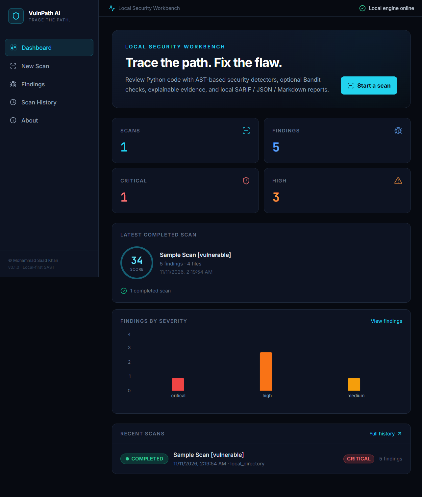
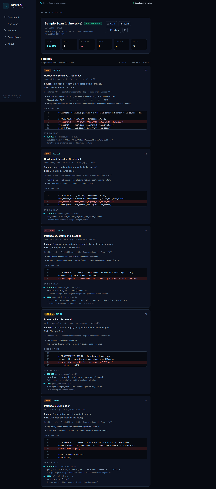

# VulnPath AI

> **Trace the path. Fix the flaw.**

VulnPath AI is a local-first static application security testing (SAST) workbench for Python projects. Upload a Python source file or ZIP archive, or run the bundled sample suite. Review detector evidence and code context in the browser, keep scan history in a local SQLite database, and export completed results as SARIF 2.1.0, JSON, or Markdown.

| Project | Details |
|---|---|
| Version | 0.1.0 |
| Supported scan language | Python (`.py`, `.pyw`) |
| Backend | Python 3.12+, FastAPI, Pydantic, aiosqlite, SQLite |
| Frontend | React 18, TypeScript, Vite, Tailwind CSS, Recharts |
| Default local API | `http://127.0.0.1:8765` |
| Default dashboard | `http://127.0.0.1:5173` |
| Data storage | `.vulnpath/vulnpath.db` |
| License | All rights reserved; see [LICENSE](./LICENSE) |

## Screenshots

The screenshots below show the dashboard and a completed scan of the bundled **vulnerable demo samples**. Any credential-like values visible in the results are intentionally fake test fixtures, not real secrets.

### Security dashboard



### Scan results and evidence



## What the project does

### Implemented

- Accepts a single Python file (`.py` or `.pyw`), a ZIP archive, or the bundled `vulnerable`, `safe`, and combined sample sets.
- Parses source using Python's standard-library AST. **The scanned program is not executed.**
- Runs built-in AST-based checks for:
  - SQL injection (CWE-89)
  - OS command injection (CWE-78)
  - Path traversal (CWE-22)
  - Hardcoded credentials (CWE-798)
  - Unsafe deserialization (CWE-502)
  - Weak cryptography (CWE-327)
- Loads additional custom rules from `rules/*.yaml` (the included pack covers insecure temporary files, SSRF patterns, and XML parsing patterns).
- Offers optional Bandit static checks when Bandit is installed in the backend Python environment and enabled for a scan.
- Tracks scan status and file progress, supports cooperative cancellation, and stores results locally.
- Displays severity, confidence, code context, evidence notes, detector source, and available source-to-sink steps for each finding.
- Provides dashboard summaries, scan history, aggregate findings search/filtering, and report downloads.
- Exports completed scans as SARIF 2.1.0, JSON, or Markdown.

Static-analysis output is heuristic evidence for analyst review, not proof of exploitability or a substitute for secure code review.

### Not implemented yet

The current release is Python-only. The following items are design or research goals, not active product capabilities:

- CodeBERT embeddings or another learned code model
- A NetworkX program dependency/call graph analysis pipeline
- A trained or calibrated Path-Aware Evidence Fusion (PAEF) model
- Interprocedural taint analysis with complete sanitizer modeling
- Automatic remediation, patch generation, or diff verification
- Scanning JavaScript/TypeScript, Java, C/C++, Go, PHP, or Ruby
- A project-management CRUD interface or authentication system

`networkx` and `@xyflow/react` appear in dependency manifests, but their presence does not mean graph analysis or interactive flow-graph visualization is implemented.

## Architecture

```text
Python file / ZIP / bundled samples
              |
       bounded ingestion
       and safe extraction
              |
       Python AST parser
              |
  +-----------+-------------------+
  |                               |
AST security detectors       YAML rules
  |                               |
  +--------- optional Bandit -----+
              |
     deduplication and
     severity-weighted summary
              |
    local SQLite persistence
              |
      FastAPI local API
              |
 React analyst workbench
              |
 SARIF / JSON / Markdown
```

The code is organized into ingestion, parsing, analysis, persistence, API, and frontend layers. See [the architecture document](./docs/design/ARCHITECTURE.md) for component boundaries and [the theme document](./docs/design/THEME.md) for the UI design tokens.

## Quick start (Windows PowerShell)

### Prerequisites

- Python 3.12 or newer (the project has been exercised with Python 3.14)
- Node.js 18 or newer and npm 9 or newer
- `uv` is recommended for Python environment setup; standard `venv` and `pip` also work

### 1. Install backend dependencies and run tests

Run these commands from the repository root:

```powershell
uv venv .venv
uv pip install -r requirements.txt -r requirements-dev.txt
.\.venv\Scripts\python.exe -m pytest backend\tests -v
```

Without `uv`, create and install into a virtual environment with:

```powershell
py -3.12 -m venv .venv
.\.venv\Scripts\python.exe -m pip install -r requirements.txt -r requirements-dev.txt
```

### 2. Start the API

From the repository root, in a PowerShell window:

```powershell
.\.venv\Scripts\python.exe -m uvicorn backend.app.main:app --host 127.0.0.1 --port 8765 --reload
```

The API health response is available at [http://127.0.0.1:8765/api/health](http://127.0.0.1:8765/api/health); interactive API documentation is at [http://127.0.0.1:8765/docs](http://127.0.0.1:8765/docs).

### 3. Start the dashboard

In a second PowerShell window:

```powershell
Set-Location frontend
npm install
npm run dev
```

Open [http://127.0.0.1:5173](http://127.0.0.1:5173). The Vite development server proxies `/api` requests to `http://127.0.0.1:8765`.

### Production frontend build

From the `frontend` directory:

```powershell
npm run build
npm run preview -- --host 127.0.0.1
```

The static production bundle is generated in `frontend/dist/`. The backend currently serves the API, not the built frontend; use the Vite preview server or deploy/serve the static bundle separately while keeping API access local.

### Optional Bandit integration

Bandit is not a required dependency. To enable it, install it into the same Python environment as the backend:

```powershell
.\.venv\Scripts\python.exe -m pip install bandit
```

Then select **Enable Bandit integration** when starting a scan. If Bandit is unavailable, the built-in AST and YAML checks remain usable.

## Using the workbench

1. Start the API and frontend as described above.
2. Select **New Scan**.
3. Choose a Python file, ZIP archive, or bundled sample set.
4. Optionally enter a scan name and enable Bandit.
5. Follow the scan status and progress on the results page. Active scans can be cancelled.
6. Review findings, code context, evidence notes, and detector-provided path steps.
7. Download a completed scan as SARIF, JSON, or Markdown, or review it later in Scan History.

The **Findings** page supports searching by title, CWE, file, and function, and filtering by severity. Scan history is stored locally and can be deleted after a scan is no longer active.

## API reference

All routes are local API routes under `/api`. Visit `/docs` while the backend is running for the OpenAPI interface.

| Method | Route | Purpose |
|---|---|---|
| `GET` | `/api/health` | Service, runtime, and capability metadata |
| `GET` | `/api/scans/` | Recent scan history (`limit`, maximum 200) |
| `POST` | `/api/scans/upload/file` | Start a scan of a Python file |
| `POST` | `/api/scans/upload/zip` | Safely extract and scan a ZIP archive |
| `POST` | `/api/scans/samples/{sample_set}` | Start a scan of bundled examples (`vulnerable`, `safe`, or `all`) |
| `GET` | `/api/scans/findings/` | Recent findings from completed scans (maximum 1,000) |
| `GET` | `/api/scans/{scan_id}` | Get status, summary, progress, and findings |
| `POST` | `/api/scans/{scan_id}/cancel` | Request cooperative cancellation |
| `DELETE` | `/api/scans/{scan_id}` | Delete a non-active scan and its findings |
| `GET` | `/api/scans/{scan_id}/report?format={format}` | Download a completed scan report (`json`, `sarif`, or `markdown`) |

File/ZIP upload form fields are `file`, `project_name`, and `enable_bandit`. Scan creation returns a `scan_id`; poll the scan detail route to observe status. Statuses include `pending`, `extracting`, `parsing`, `analyzing`, `fusing`, `completed`, `failed`, and `cancelled` (not every intermediate status is currently emitted).

## Configuration and local data

The backend reads settings with the `VULNPATH_` environment prefix. Settings can also be supplied through a root `.env` file (which should not be committed).

| Setting | Default | Description |
|---|---:|---|
| `VULNPATH_DATA_DIR` | `.vulnpath` | Local database directory |
| `VULNPATH_DB_NAME` | `vulnpath.db` | SQLite database filename |
| `VULNPATH_HOST` | `127.0.0.1` | Configured host default; the Uvicorn command above explicitly binds loopback |
| `VULNPATH_PORT` | `8765` | Configured port default; the Uvicorn command above explicitly selects port 8765 |
| `VULNPATH_MAX_ARCHIVE_SIZE_BYTES` | 52,428,800 (50 MiB) | Maximum uploaded ZIP size |
| `VULNPATH_MAX_SINGLE_FILE_SIZE_BYTES` | 5,242,880 (5 MiB) | Maximum source-file size |
| `VULNPATH_MAX_TOTAL_EXTRACTED_BYTES` | 104,857,600 (100 MiB) | Maximum ZIP expansion size |
| `VULNPATH_MAX_FILE_COUNT` | `500` | Maximum archive entries / discovered files |
| `VULNPATH_CORS_ORIGINS` | Loopback origins for ports 8765 and 5173 | Allowed browser origins |

The default SQLite database is `.vulnpath/vulnpath.db`; the `.vulnpath/` directory is ignored by Git. Back up or remove this directory to manage local scan history. The `projects` table exists in the schema for future project features; project CRUD endpoints are not currently exposed.

The sample Uvicorn command explicitly chooses its host and port. If you change either, pass the desired values in the Uvicorn command and update the Vite proxy target in `frontend/vite.config.ts` to use the matching API port.

## Safety and privacy

- Bind the API to loopback (`127.0.0.1`). Do not expose this development service to an untrusted network.
- The source being analyzed is parsed and inspected statically; VulnPath AI does not execute the scanned program.
- ZIP extraction rejects unsafe paths and symbolic links, and enforces archive, entry-count, per-file, and total-extracted-size limits.
- No source file or scan result is sent to a VulnPath cloud service. The current frontend loads Inter and JetBrains Mono from Google Fonts when external network access is available; local system font fallbacks are used when it is not.
- The optional Bandit integration runs the Bandit static analyzer in the local backend environment.
- Upload and database data are kept on the machine, but local files and reports may contain sensitive code or findings. Restrict access to the machine and protect backups accordingly.
- Findings may be false positives or miss vulnerabilities. Validate results with code review and appropriate testing.

## Tests and verification

Run the backend tests from the repository root:

```powershell
.\.venv\Scripts\python.exe -m pytest backend\tests -v
```

Build and type-check the frontend from `frontend/`:

```powershell
npm run build
```

The test suite covers foundation and path-safety behavior, API and scan lifecycle behavior, engine detections, and static integrations. Sample programs under `samples/` are regression fixtures and should be treated as deliberately vulnerable demonstration code.

### Troubleshooting

- **Dashboard reports “API offline”:** confirm Uvicorn is running at `127.0.0.1:8765`, then check `/api/health`.
- **Port already in use:** choose a different API port in the Uvicorn command and update `frontend/vite.config.ts`'s proxy target to match.
- **Bandit is not included in results:** install it in the backend virtual environment and enable it for that scan.
- **No Python files found in a ZIP:** the archive must contain `.py` or `.pyw` files; oversized or unsafe entries are rejected.
- **No scan history after moving the project:** the default `.vulnpath/` database is relative to the backend's current working directory. Set `VULNPATH_DATA_DIR` to a stable absolute local path if needed.

## Repository layout

```text
backend/
  app/
    analysis/       AST detectors, YAML rules, optional Bandit adapter, scan engine
    api/            FastAPI health and scan routes
    core/           Runtime configuration, constants, and path safety
    database/       SQLite schema and repository
    ingestion/      Upload targets and safe ZIP extraction
    parsing/        Python AST parsing and code context extraction
    schemas/        Pydantic scan and finding models
    services/       Scan orchestration and report export
  tests/             Backend unit and API tests
frontend/
  src/
    api/             Typed API client
    components/      Shared dashboard and finding UI
    pages/           Dashboard, scan form/results, history, findings, about
    styles/          Tailwind and global styles
docs/
  design/            Architecture and visual design
  decisions/         Architecture decision records
  screenshots/       README dashboard and scan-results captures
rules/               Custom YAML security rules
samples/
  safe/              Safer examples for regression testing
  vulnerable/        Intentionally vulnerable demonstration examples
models/              Model registry documentation; no deployed weights
```

## Project phases

| Phase | Status | Scope |
|---|---|---|
| 0 — Foundations | Complete | Configuration, safety boundaries, schemas, SQLite, health API |
| 1 — Static analysis | Complete | Python AST parsing, native detectors, evidence, deterministic summary |
| 2 — Integrations | Complete | Custom YAML rules and optional Bandit adapter |
| 3 — API and persistence | Complete | Scan lifecycle, local history, findings, report generation |
| 4 — Analyst workbench | Complete | Dashboard, upload/sample flows, progress/results, triage, history, exports |
| Research extensions | Planned | Learned semantics, dependency graphs, calibrated PAEF, remediation, more languages |

## License, attribution, and third-party notices

Copyright (c) 2026 Mohammad Saad Khan. All rights reserved. Review [LICENSE](./LICENSE), [PROVENANCE.md](./PROVENANCE.md), and [THIRD_PARTY_NOTICES](./THIRD_PARTY_NOTICES) for licensing, authorship, and dependency attributions.
